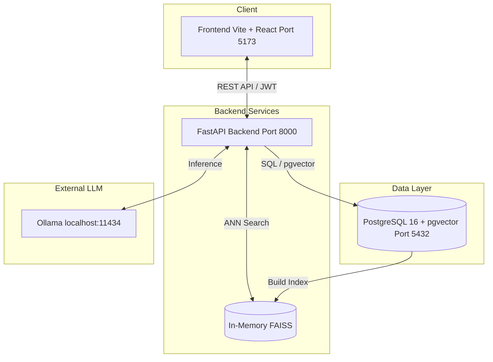

# Project Assistant — Document-to-Action AI Workflow

An AI-powered application that analyses project documents (meeting notes, requirement drafts, decision records) and extracts structured findings — facts, decisions, assumptions, risks, open questions, and action items — with full source attribution. Supports human review, reclassification, conflict resolution, and saving of reviewed action summaries.

---

## Table of Contents

1. [Architecture Overview](#architecture-overview)
2. [Project Structure](#project-structure)
3. [Completed & Excluded Scope](#completed--excluded-scope)
4. [Prerequisites & Setup](#prerequisites--setup)
5. [Environment Variables](#environment-variables)
6. [Known Limitations](#known-limitations)
7. [Deployment Details](#deployment-details)
8. [API Endpoints](#api-endpoints)
9. [Frontend Routes](#frontend-routes)
10. [AI Workflow](#ai-workflow)
11. [Database Migrations](#database-migrations)
12. [Testing](#testing)
13. [Sample Documents](#sample-documents)
14. [Tech Stack](#tech-stack)

---

## Architecture Overview



The backend proxies LLM calls to **Ollama** running on the host machine. Embedding is handled locally via `sentence-transformers/all-MiniLM-L6-v2` (384-dim vectors). Document chunks are stored in PostgreSQL with the **pgvector** extension and indexed in an in-memory **FAISS** index for fast ANN search.

---

## Project Structure

```
project_assistant/
├── docker-compose.yml              # Dev orchestration: db, backend, frontend
├── .env                            # Secrets and config (not committed)
├── README.md
│
├── backend/
│   ├── Dockerfile                  # Python 3.12-slim + uv + libopenblas
│   ├── requirements.txt            # Pinned Python dependencies
│   ├── pytest.ini                  # asyncio_mode = strict
│   ├── alembic.ini                 # Alembic configuration
│   ├── alembic/
│   │   ├── env.py                  # Async Alembic env with pgvector support
│   │   └── versions/               # 9 migration scripts
│   ├── app/
│   │   ├── main.py                 # FastAPI app factory, CORS, lifespan
│   │   ├── config.py               # pydantic-settings (env vars)
│   │   ├── database.py             # Async SQLAlchemy engine + session
│   │   ├── dependencies.py         # get_db, get_current_user
│   │   ├── models/
│   │   │   ├── user.py             # User, TokenBlacklist
│   │   │   ├── knowledge.py        # KnowledgeDocument, DocumentChunk
│   │   │   └── project.py          # Project (document_ids ARRAY, JSONB cache)
│   │   ├── schemas/
│   │   │   ├── auth.py             # Register, Login, Token, User responses
│   │   │   ├── knowledge.py        # Document CRUD, Search contracts
│   │   │   ├── extraction.py       # ExtractionResult + 10 sub-schemas
│   │   │   └── project.py          # Project CRUD, Review contracts
│   │   ├── routers/
│   │   │   ├── auth.py             # /auth/* (register, login, refresh, logout, me)
│   │   │   ├── knowledge.py        # /knowledge/* (upload, list, download, delete, search, text)
│   │   │   └── project.py          # /projects/* (CRUD, analyze, review, remove-doc)
│   │   ├── services/
│   │   │   ├── auth.py             # Registration, login, token blacklist logic
│   │   │   ├── extraction.py       # LangGraph agent + 4-phase structured pipeline
│   │   │   ├── vectorization.py    # PDF/DOCX/TXT load → split → embed → pgvector + FAISS
│   │   │   └── faiss_service.py    # Singleton FAISS IndexIDMap(IndexFlatIP) wrapper
│   │   └── utils/
│   │       └── security.py         # bcrypt hashing, JWT create/decode
│   ├── tests/
│   │   ├── conftest.py             # Shared fixtures: users, DB, projects, docs
│   │   ├── test_extraction_schemas.py   # Pydantic schema validation
│   │   ├── test_extraction_pipeline.py  # Pipeline assembly + Phase 4 compression
│   │   ├── test_faiss_service.py        # FAISS build/add/search with synthetic vectors
│   │   ├── test_auth.py                 # Register, login, refresh, logout
│   │   ├── test_knowledge_crud.py       # List, delete, search
│   │   ├── test_routers.py              # Review save endpoint
│   │   └── test_project_crud.py         # Project CRUD, analyze, review
│   └── uploads/                    # Persisted uploaded files (Docker volume)
│
├── frontend/
│   ├── Dockerfile                  # Node 20-alpine
│   ├── package.json                # React 19, Vite 6, Tailwind, React Router 7
│   ├── vite.config.ts              # Proxy /auth, /knowledge, /projects → backend:8000
│   ├── tailwind.config.ts
│   ├── tsconfig.json
│   ├── index.html
│   └── src/
│       ├── main.tsx                # Entry point
│       ├── App.tsx                 # Route definitions
│       ├── index.css               # Tailwind + custom tokens
│       ├── api/
│       │   ├── client.ts           # Axios instance with JWT interceptor
│       │   ├── knowledge.ts        # Type-safe knowledge API calls
│       │   └── project.ts          # Type-safe project API calls + ExtractionResult types
│       ├── components/
│       │   ├── AuthenticatedLayout.tsx  # Sidebar + main content shell
│       │   ├── Sidebar.tsx              # Glassmorphism sidebar with project list
│       │   ├── ProtectedRoute.tsx       # Redirects to /login if unauthenticated
│       │   ├── GuestRoute.tsx           # Redirects to /dashboard if authenticated
│       │   ├── ProjectNavbar.tsx        # Stage nav: Upload → Results → Review
│       │   ├── ThemeToggle.tsx          # Dark/light mode toggle
│       │   ├── utils.ts                 # cn() classname helper
│       │   └── ui/                      # Reusable UI primitives
│       ├── context/
│       │   ├── AuthContext.tsx     # JWT token management, user state
│       │   └── ThemeContext.tsx    # Dark mode theme
│       └── pages/
│           ├── Login.tsx           # Email/password login
│           ├── Register.tsx        # Account creation
│           ├── Dashboard.tsx       # User profile card
│           ├── Knowledge.tsx       # Knowledge base: upload, list, download, delete
│           ├── ProjectNew.tsx      # 3-slot document upload + poll → Start Analysis
│           ├── ProjectResults.tsx  # Structured extraction display (10 categories)
│           └── ProjectReview.tsx   # Split-pane review workspace + document viewer
│
└── test-docs/                      # Sample documents for testing
    ├── Architecture_Spec.md
    ├── Meeting_Transcript_Kickoff.md
    ├── Meeting_Transcript_Kickoff.txt
    ├── PRD_ProjectNova.docx
    ├── PRD_ProjectNova.md
    ├── Prd projectnova.pdf
    └── knowledge-base-docs/
        ├── ai_governance_policy.txt
        ├── api_security_policy.txt
        └── data_retention_policy.txt
```

---

## Completed & Excluded Scope

### Completed Scope
- **Document Ingestion**: Parsing of PDF, DOCX, and TXT files, chunking, and generation of embeddings using HuggingFace.
- **Local AI Pipeline**: Full integration with local Ollama for privacy-preserving, structured JSON extraction.
- **Advanced Agent Workflow**: A LangGraph agent that autonomously retrieves project documents and cross-references organizational policies via FAISS ANN search.
- **Structured Outputs**: 4-phase Pydantic-enforced LLM extraction to guarantee consistent data shapes without regex hacks.
- **Review Workspace**: A robust React split-pane interface for human-in-the-loop validation, conflict resolution, and document viewing.

### Intentionally Excluded Scope
- **Multi-user Collaboration**: No real-time simultaneous editing (e.g., WebSockets/CRDTs) of project results among multiple users.
- **Advanced RBAC**: Only simple user authentication exists. No organization/team groupings or granular document permissions.
- **Third-Party Integrations**: No direct export to Jira, Confluence, Trello, or Slack.
- **Cloud LLM Fallback**: Hardcoded to local Ollama; no built-in OpenAI/Anthropic fallback.
- **Email Notifications**: Asynchronous tasks do not currently notify users via email when finished.

---

## Prerequisites & Setup

### Prerequisites

| Tool                                | Version | Purpose                           |
| ----------------------------------- | ------- | --------------------------------- |
| Docker + Docker Compose             | Latest  | Container orchestration           |
| Ollama                              | Latest  | Local LLM inference               |
| `gpt-oss:120b-cloud` (or any model) | —       | Pulled into Ollama for extraction |

**Pull the LLM model into Ollama:**

```bash
ollama pull gpt-oss:120b-cloud
```

> Any Ollama model can be used — change `OLLAMA_MODEL` in `.env`. The code uses `with_structured_output()` (JSON schema mode), so the model must support structured JSON output.

### Quick Start (Docker - Recommended)

1. **Clone and configure**
   ```bash
   cp .env.example .env
   ```
2. **Build and start**
   ```bash
   docker compose up -d --build
   ```
3. **Verify**
   - Backend health check: `curl http://localhost:8000/health`
   - Frontend: `http://localhost:5173`

On first startup, Alembic migrations run automatically, the HuggingFace embedding model downloads (~90 MB), and the FAISS index builds from existing vectors.

### Typical Usage Flow

1. **Register** an account at `http://localhost:5173/register`
2. **Upload knowledge-base policies** at `/knowledge` (drag-and-drop `.txt`, `.pdf`, or `.docx` files)
3. **Create a project** at `/project/new` — upload 1–3 project documents
4. **Wait for indexing** — the UI polls every 3 seconds until all documents show "Ready"
5. **Start Analysis** — triggers the AI pipeline (may take 20–60 seconds)
6. **Review results** at `/project/:id/results` — see extracted facts, decisions, risks, conflicts, and policy gaps
7. **Review & finalize** at `/project/:id/review` — reclassify facts, resolve conflicts, approve/reject action items, save summary

### Local Development (Without Docker)

If you prefer running the services directly on your host machine:

1. Ensure PostgreSQL 16 is running with the `pgvector` extension installed.
2. Update `.env` to point `DATABASE_URL` to your local Postgres instance.
3. **Backend**:
   ```bash
   cd backend
   python -m venv .venv
   source .venv/bin/activate
   pip install -r requirements.txt
   alembic upgrade head
   uvicorn app.main:app --reload
   ```
4. **Frontend**:
   ```bash
   cd frontend
   npm install
   npm run dev
   ```

---

## Environment Variables

Create a `.env` file in the project root:

```ini
# ── PostgreSQL ──────────────────────────────
POSTGRES_USER=postgres
POSTGRES_PASSWORD=postgres
POSTGRES_DB=project_assistant

# ── Backend (FastAPI) ──────────────────────
DATABASE_URL=postgresql+asyncpg://postgres:postgres@db:5432/project_assistant
JWT_SECRET_KEY=change-me-in-production-use-a-random-64-char-string
JWT_ALGORITHM=HS256
ACCESS_TOKEN_EXPIRE_MINUTES=15
REFRESH_TOKEN_EXPIRE_DAYS=7
CORS_ORIGINS=http://localhost:5173

# ── LLM (Ollama) ───────────────────────────
OLLAMA_BASE_URL=http://host.docker.internal:11434
OLLAMA_MODEL=gpt-oss:120b-cloud
OLLAMA_NUM_CTX=65536
OLLAMA_NUM_PREDICT=16384

# ── Embedding ───────────────────────────────
EMBEDDING_MODEL=sentence-transformers/all-MiniLM-L6-v2
CHUNK_SIZE=1000
CHUNK_OVERLAP=200
SEARCH_TOP_K=5

# ── Frontend ────────────────────────────────
VITE_API_BASE_URL=http://localhost:8000
```

> **macOS note**: Use `http://host.docker.internal:11434` for `OLLAMA_BASE_URL` so the Docker container can reach Ollama on the host.

---

## Known Limitations

- **In-Memory FAISS Scaling**: The FAISS index is held in-memory via a singleton wrapper (`faiss_service.py`). This prevents the backend from scaling horizontally (multiple worker nodes) out of the box. A transition to a distributed vector store (or relying solely on pgvector's HNSW index) is required for high availability across multiple backend instances.
- **LLM Context Limits**: The local LLM context window limits how much cross-document context can be injected into the Phase 2 (Conflict) and Phase 3 (Gap Analysis) prompts. Exceedingly large projects might suffer from context truncation.
- **Text-Only PDF Parsing**: The current extraction relies purely on text extraction. Images, charts, and complex table layouts in PDFs are not parsed via OCR.

---

## Deployment Details

There are two recommended architectures for deploying Project Assistant to production:

### Option A: AWS Stack (Enterprise)

#### 1. Database Layer
- Use **Amazon RDS for PostgreSQL**.
- Ensure you enable the `pgvector` extension on your RDS instance.
- Ensure the database is placed in a private subnet for security.

#### 2. Backend (FastAPI)
- Containerize the FastAPI backend and push the image to **Amazon ECR**.
- Deploy using **Amazon ECS with Fargate**.
- **Crucial limitation regarding FAISS**: Because the current FAISS implementation is in-memory per-process, you must either limit to a single Fargate task (vertical scaling) or transition the FAISS logic fully to RDS pgvector if running multiple instances.
- For the LLM, either run Ollama on an EC2 instance equipped with GPUs (e.g., `g5` instances) and point `OLLAMA_BASE_URL` to it, or transition the code to use a managed LLM API (like AWS Bedrock).

#### 3. Frontend (React/Vite)
- The frontend is a static SPA. Build it using `npm run build`.
- Host the `dist` folder on **Amazon S3** and serve it via **Amazon CloudFront** for global CDN caching.

---

### Option B: Modern Serverless Stack (Vercel, Railway, Supabase)

#### 1. Database Layer (Supabase)
- Create a new project in **Supabase**.
- Supabase natively supports the `pgvector` extension. Enable it via the SQL Editor (`CREATE EXTENSION IF NOT EXISTS vector;`).
- Retrieve your session-pooled connection string (port 6543) and set it as your `DATABASE_URL`.

#### 2. Backend (Railway)
- Deploy the FastAPI backend on **Railway** via their GitHub integration.
- Railway will automatically detect the Python environment and `Dockerfile`.
- Map your environment variables (like the Supabase `DATABASE_URL`, JWT secrets, etc.) in the Railway dashboard.
- *Note on LLM*: Railway does not provide GPU instances natively. You will need to host Ollama on a GPU cloud provider (like RunPod or Lambda Labs) or modify the backend to use a hosted LLM API (e.g., OpenAI or Anthropic).

#### 3. Frontend (Vercel)
- Connect your GitHub repository to **Vercel**.
- Vercel will automatically detect the Vite React project and use the provided `vercel.json` for routing rules.
- Add your `VITE_API_BASE_URL` pointing to your Railway backend URL in the Vercel environment variables settings.

---

## API Endpoints

### Auth (`/auth`)

| Method | Path             | Description                                    | Auth   |
| ------ | ---------------- | ---------------------------------------------- | ------ |
| `POST` | `/auth/register` | Create account                                 | No     |
| `POST` | `/auth/login`    | Login → access token + httpOnly refresh cookie | No     |
| `POST` | `/auth/refresh`  | Exchange refresh cookie for new access token   | Cookie |
| `POST` | `/auth/logout`   | Blacklist refresh token + clear cookie         | Cookie |
| `GET`  | `/auth/me`       | Get current user profile                       | Bearer |

### Knowledge Base (`/knowledge`)

| Method   | Path                             | Description                                     | Auth   |
| -------- | -------------------------------- | ----------------------------------------------- | ------ |
| `POST`   | `/knowledge/upload`              | Upload a `.pdf`/`.docx`/`.txt` file (max 25 MB) | Bearer |
| `GET`    | `/knowledge/documents`           | List all public documents (paginated)           | Bearer |
| `GET`    | `/knowledge/documents/{id}`      | Download document file                          | Bearer |
| `GET`    | `/knowledge/documents/{id}/text` | Get reconstructed text from chunks              | Bearer |
| `DELETE` | `/knowledge/documents/{id}`      | Delete document + chunks + FAISS entries        | Bearer |
| `POST`   | `/knowledge/search`              | Semantic search via FAISS ANN                   | Bearer |

### Projects (`/projects`)

| Method   | Path                              | Description                                           | Auth   |
| -------- | --------------------------------- | ----------------------------------------------------- | ------ |
| `POST`   | `/projects`                       | Create project with 1–3 files (multipart)             | Bearer |
| `GET`    | `/projects`                       | List user's projects (paginated)                      | Bearer |
| `GET`    | `/projects/{id}`                  | Get project with live doc statuses                    | Bearer |
| `DELETE` | `/projects/{pid}/documents/{did}` | Remove doc from project (deletes project if last doc) | Bearer |
| `POST`   | `/projects/{id}/analyze`          | Run AI extraction pipeline (`?force=true` to re-run)  | Bearer |
| `PUT`    | `/projects/{id}/review`           | Save user-reviewed action summary                     | Bearer |

### Health

| Method | Path      | Description                        |
| ------ | --------- | ---------------------------------- |
| `GET`  | `/health` | Liveness probe → `{"status":"ok"}` |

---

## Frontend Routes

| Path                   | Component        | Auth       | Description                             |
| ---------------------- | ---------------- | ---------- | --------------------------------------- |
| `/login`               | `Login`          | Guest only | Email + password login                  |
| `/register`            | `Register`       | Guest only | Create new account                      |
| `/dashboard`           | `Dashboard`      | Required   | User profile card                       |
| `/knowledge`           | `Knowledge`      | Required   | Upload/manage knowledge base docs       |
| `/project/new`         | `ProjectNew`     | Required   | Create a new project (upload 1-3 files) |
| `/project/:id`         | `ProjectNew`     | Required   | Re-open existing project                |
| `/project/:id/results` | `ProjectResults` | Required   | View AI extraction results              |
| `/project/:id/review`  | `ProjectReview`  | Required   | Review workspace with document viewer   |

---

## AI Workflow

The extraction pipeline has two stages:

### Stage A — LangGraph ReAct Agent

A LangGraph agent with 2 async tools autonomously explores:

1. **`retrieve_document_chunks(filename)`** — Fetches pre-vectorized chunks from pgvector for each uploaded document. Returns `[DOCUMENT:...] [SECTION:...]`-labeled text.
2. **`search_policy_kb(query)`** — Searches the organizational knowledge base via FAISS ANN. Returns `[POLICY:...] [SECTION:...]`-labeled chunks.

The agent autonomously retrieves all documents, then searches for relevant policies. The agent then terminates and outputs a terse list of discovered topics. Its narrative output is not consumed directly — the extracted policy lines feed into Stage B.

### Stage B — 4-Phase Structured Pipeline

Each phase is a **separate LLM call** with `with_structured_output()` (Ollama JSON schema mode), binding output to strict Pydantic schemas:

| Phase | Schema                    | Purpose                                                                                                                                 |
| ----- | ------------------------- | --------------------------------------------------------------------------------------------------------------------------------------- |
| **1** | `PerDocumentExtraction`   | Per-document: identify document type, extract facts/decisions/assumptions/risks/open questions/action items — one LLM call per document |
| **2** | `ConflictDetectionResult` | Cross-document: detect contradictory statements and repeated content                                                                    |
| **3** | `PolicyGapResult`         | Policy compliance: find missing actions and missing questions based on policy chunks                                                    |
| **4** | `SummaryResult`           | Synthesise a compressed digest of Phases 1–3 into an executive summary                                                                  |

### Result Assembly

All 4 phases are flattened into the final `ExtractionResult`, which includes:

- `document_types` — per-document classification (meeting_notes, requirement_draft, implementation_notes, project_update, decision_record)
- `summary` — Executive summary (Markdown)
- `facts`, `decisions`, `assumptions`, `risks`, `open_questions`, `action_items` — per-document with source attribution
- `document_conflicts`, `repeated_statements` — cross-document analysis
- `missing_actions`, `missing_questions` — policy-gap suggestions

Every extracted item carries `source_document` + `source_section` for full traceability back to the original text.

### Key Design Decisions

- **AI does not create or assign tasks** — action items are only extracted from documents, never invented
- **Results are cached** in the `projects.analysis_result` JSONB column — reopening shows results instantly
- **Phase 4 compression** — full Phase 1–3 JSON can exceed 10K tokens; a compressed digest surfaces all signals without dilution
- **Agent recursion limit**: 10 iterations max (`AGENT_MAX_ITERATIONS`)

---

## Database Migrations

Migrations use Alembic with async SQLAlchemy. They run automatically on container start:

```bash
# Manual migration commands (inside the backend container):
docker compose exec backend alembic upgrade head          # Apply all migrations
docker compose exec backend alembic revision --autogenerate -m "description"  # Create new migration
docker compose exec backend alembic downgrade -1          # Rollback last migration
```

**Migration history** (9 versions in `backend/alembic/versions/`):

| Revision       | Description                                                  |
| -------------- | ------------------------------------------------------------ |
| `0b95bf9b4587` | Initial schema (users, knowledge_documents, document_chunks) |
| `a1b2c3d4e5f6` | Add knowledge_documents table refinements                    |
| `c7d8e9f0a1b2` | Add document_chunks with pgvector embedding column           |
| `d4e5f6a7b8c9` | Add status column to knowledge_documents                     |
| `e5f6a7b8c9d0` | Add projects table with ARRAY(UUID) + JSONB cache columns    |
| `f0a1b2c3d4e5` | Add metadata_json to document_chunks                         |
| `g1h2i3j4k5l6` | Add visibility column to knowledge_documents                 |
| `h2i3j4k5l6m7` | Add analysis_result JSONB to projects                        |
| `i3j4k5l6m7n8` | Add review_summary JSONB to projects                         |

---

## Testing

**38 tests** across 7 files, all passing:

```bash
# Run all tests
docker compose exec backend python -m pytest tests/ -v

# Run a specific test file
docker compose exec backend python -m pytest tests/test_faiss_service.py -v

# Run a specific test function
docker compose exec backend python -m pytest tests/test_faiss_service.py::test_search_self_match_perfect -v
```

### Test Coverage

| File                          | Tests | What it covers                                                                                          |
| ----------------------------- | ----- | ------------------------------------------------------------------------------------------------------- |
| `test_extraction_schemas.py`  | 3     | Pydantic literal enforcement (confidence, severity), empty conflict handling                            |
| `test_extraction_pipeline.py` | 7     | Document type assembly, per-doc flattening, empty docs, conflict/gap assembly, Phase 4 compression      |
| `test_faiss_service.py`       | 5     | Build index, add chunks (idempotent mapping), search (top-k, self-match ≈1.0, empty index)              |
| `test_auth.py`                | 5     | Register (success, duplicate 409), login (success, invalid 401), refresh (missing cookie 401), logout   |
| `test_knowledge_crud.py`      | 4     | List (empty, with data), delete (404), search (no hits, with hits)                                      |
| `test_routers.py`             | 3     | Review save (success, 409 no-analysis, 403 wrong user)                                                  |
| `test_project_crud.py`        | 5     | List empty, get 404, analyze (cached return, force re-run, 403), review save (success, 409 no-analysis) |

All tests use mocked DB sessions — no real PostgreSQL required. The FAISS tests use a real `FAISSService` instance with synthetic 384-d normalized vectors.

---

## Sample Documents

The `test-docs/` directory contains example documents for testing the pipeline:

```
test-docs/
├── Meeting_Transcript_Kickoff.txt # Kickoff meeting transcript (plain text)
├── PRD_ProjectNova.docx           # Product requirements document (DOCX)
├── Prd projectnova.pdf            # Product requirements document (PDF)
└── knowledge-base-docs/
    ├── ai_governance_policy.pdf   # AI governance policy for policy-gap analysis
    ├── api_security_policy.pdf    # API security policy
    └── data_retention_policy.pdf  # Data retention policy
```

**Testing workflow**: Upload the 3 policy files to the Knowledge Base, then create a project with the Architecture Spec, Meeting Transcript, and PRD to see cross-document conflict detection and policy-gap analysis in action.

---

## Tech Stack

| Layer        | Technology                  | Version          |
| ------------ | --------------------------- | ---------------- |
| **Frontend** | React                       | 19               |
|              | Vite                        | 6                |
|              | TypeScript                  | 5.7              |
|              | Tailwind CSS                | 3.4              |
|              | React Router                | 7                |
|              | Motion (Framer)             | 12               |
|              | React Markdown              | 10               |
|              | Axios                       | 1.7              |
| **Backend**  | Python                      | 3.12             |
|              | FastAPI                     | 0.115+           |
|              | SQLAlchemy (async)          | 2.0+             |
|              | Pydantic                    | 2.0+             |
|              | Alembic                     | 1.14+            |
|              | python-jose (JWT)           | 3.3+             |
|              | passlib (bcrypt)            | 1.7+             |
| **AI/ML**    | LangChain                   | 0.3+             |
|              | LangGraph                   | 0.2+             |
|              | langchain-ollama            | 0.2+             |
|              | langchain-huggingface       | 0.1+             |
|              | sentence-transformers       | 3.0+             |
|              | FAISS                       | 1.8+             |
|              | Ollama                      | Latest           |
| **Database** | PostgreSQL                  | 16               |
|              | pgvector                    | 0.3+ (extension) |
| **Infra**    | Docker Compose              | Latest           |
|              | uv (Python package manager) | Latest           |
